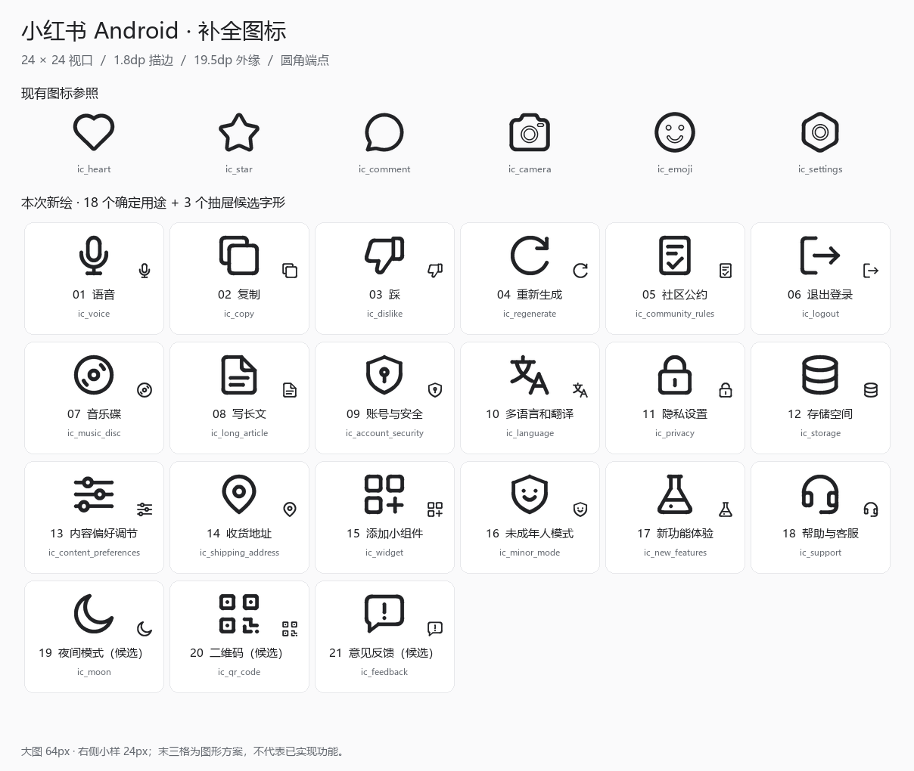

# 剩余 21 个图标交付清单

交付日期：2026-10-30。21 枚图标均为本次手工绘制的矢量路径，交付 21 份 SVG 源文件及对应的 Android VectorDrawable，已替换上一轮清单中的 21 个固定占位槽位。

2026-11-22 随 F5 移除编号 09–18 的 Android 资源。SVG 和预览用于回溯本次图标交付。

## 设计规范

- 画布：`24 × 24`；SVG 为 `viewBox="0 0 24 24"`，Android 为 `24dp / 24` 视口。
- 线宽：统一 `1.8dp`；圆角端点与连接，单色空心轮廓，界面颜色由调用处的 `tint` 控制。
- 外缘：长边约 `19.5dp`，按实际外缘居中；麦克风、文档等保留自然宽高比。
- 风格参照：现有 `ic_heart / ic_star / ic_comment / ic_camera / ic_emoji / ic_settings`。
- SVG 全部使用路径，不依赖字体、外部图片或运行时绘图代码。现有界面各处的尺寸、颜色及点击回调沿用原实现。

## 整套预览

首行是现有图标，下方为本次新绘；每格包含 64px 大图及 24px 小样。

[查看 24px 原尺寸预览](icons-2026-10-30/icons-24px.png)。PNG 仅用于预览，正式素材使用下表中的 SVG / XML。

## 逐项清单

| 编号 | 预览 | 图标与使用位置 | 资源名 | 源文件 | Android |
|---|---|---|---|---|---|
| 01 |  | 语音 · AI 输入栏 | `ic_voice` | [SVG](icons-2026-10-30/ic_voice.svg) | [XML](../../app/src/main/res/drawable/ic_voice.xml) |
| 02 |  | 复制 · AI 回复操作栏 | `ic_copy` | [SVG](icons-2026-10-30/ic_copy.svg) | [XML](../../app/src/main/res/drawable/ic_copy.xml) |
| 03 |  | 踩 · AI 回复操作栏 | `ic_dislike` | [SVG](icons-2026-10-30/ic_dislike.svg) | [XML](../../app/src/main/res/drawable/ic_dislike.xml) |
| 04 |  | 重新生成 · AI 回复操作栏 | `ic_regenerate` | [SVG](icons-2026-10-30/ic_regenerate.svg) | [XML](../../app/src/main/res/drawable/ic_regenerate.xml) |
| 05 |  | 社区公约 · 个人页抽屉 | `ic_community_rules` | [SVG](icons-2026-10-30/ic_community_rules.svg) | [XML](../../app/src/main/res/drawable/ic_community_rules.xml) |
| 06 |  | 退出登录 · 个人页抽屉 | `ic_logout` | [SVG](icons-2026-10-30/ic_logout.svg) | [XML](../../app/src/main/res/drawable/ic_logout.xml) |
| 07 |  | 音乐碟 · 视频详情作者行 | `ic_music_disc` | [SVG](icons-2026-10-30/ic_music_disc.svg) | [XML](../../app/src/main/res/drawable/ic_music_disc.xml) |
| 08 |  | 写长文 · 写文字页底部卡片 | `ic_long_article` | [SVG](icons-2026-10-30/ic_long_article.svg) | [XML](../../app/src/main/res/drawable/ic_long_article.xml) |
| 09 |  | 账号与安全 · 原设置页 | `ic_account_security` | [SVG](icons-2026-10-30/ic_account_security.svg) | 已移除 |
| 10 |  | 多语言和翻译 · 原设置页 | `ic_language` | [SVG](icons-2026-10-30/ic_language.svg) | 已移除 |
| 11 |  | 隐私设置 · 原设置页 | `ic_privacy` | [SVG](icons-2026-10-30/ic_privacy.svg) | 已移除 |
| 12 |  | 存储空间 · 原设置页 | `ic_storage` | [SVG](icons-2026-10-30/ic_storage.svg) | 已移除 |
| 13 |  | 内容偏好调节 · 原设置页 | `ic_content_preferences` | [SVG](icons-2026-10-30/ic_content_preferences.svg) | 已移除 |
| 14 |  | 收货地址 · 原设置页 | `ic_shipping_address` | [SVG](icons-2026-10-30/ic_shipping_address.svg) | 已移除 |
| 15 |  | 添加小组件 · 原设置页 | `ic_widget` | [SVG](icons-2026-10-30/ic_widget.svg) | 已移除 |
| 16 |  | 未成年人模式 · 原设置页 | `ic_minor_mode` | [SVG](icons-2026-10-30/ic_minor_mode.svg) | 已移除 |
| 17 |  | 新功能体验 · 原设置页 | `ic_new_features` | [SVG](icons-2026-10-30/ic_new_features.svg) | 已移除 |
| 18 |  | 帮助与客服 · 原设置页 | `ic_support` | [SVG](icons-2026-10-30/ic_support.svg) | 已移除 |
| 19 |  | 夜间模式候选 · 抽屉底部第 1 格 | `ic_moon` | [SVG](icons-2026-10-30/ic_moon.svg) | [XML](../../app/src/main/res/drawable/ic_moon.xml) |
| 20 |  | 二维码候选 · 抽屉底部第 2 格 | `ic_qr_code` | [SVG](icons-2026-10-30/ic_qr_code.svg) | [XML](../../app/src/main/res/drawable/ic_qr_code.xml) |
| 21 |  | 意见反馈候选 · 抽屉底部第 3 格 | `ic_feedback` | [SVG](icons-2026-10-30/ic_feedback.svg) | [XML](../../app/src/main/res/drawable/ic_feedback.xml) |

## 抽屉底部三格的设计假设

现有代码仅重复绘制三个占位图标，没有名称、数据字段或点击事件；归档线框也没有定义这三格的用途。因此第 19–21 枚为本轮提出的候选字形，按从左至右顺序展示。它们保持装饰性、不可点击，不表示已实现夜间模式、二维码或意见反馈功能。二维码图案仅为图标，不含可扫描内容。

## 接入与校验记录

- AI、抽屉、设置、视频作者行及长文卡片的固定图标占位已全部替换；图片加载/解码失败、视频地址为空时的兜底占位继续保留。
- 21 枚新图标的几何检查通过：均为 24 视口、1.8dp 线宽、约 19.5dp 长边；已检查整套等大对照图及 24px 小样。
- 全量 63 枚图标扫描另报告两项既有偏差：`ic_about` 线宽 1.5dp、`ic_live` 长边 20.8dp。本次未改动这两枚既有资源。
- 本轮沿用上轮约定，不运行单元测试或界面测试。编译打包结果见 [客户端交付说明](../交付说明-Android客户端.md)。
